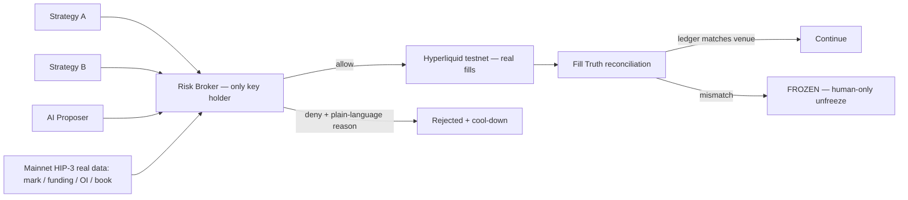

# VetoOS

[](https://github.com/rectinajh/vetoos/actions/workflows/ci.yml)
[](LICENSE)


**The AI-era risk-control OS for Hyperliquid HIP-3.**
*Don't trust the agent. Verify the fill. Enforce the rules. Outlast FOMO.*

VetoOS is an open-source risk broker that sits between your strategies/AI and
**real HIP-3 markets**. Models propose; rules dispose. Every order must pass a
deterministic rule engine, and every fill is reconciled against the venue's
own account state. If the books don't match reality, the broker freezes —
no exceptions, no appeals from the model.

Built for the [Colosseum Crypto World's Fair](https://colosseum.com/worldsfair) · Hyperliquid track.
**Proof of what actually ran:** [docs/EVIDENCE.md](docs/EVIDENCE.md) (mainnet reads, testnet fills with
oids/tx hashes, a real HIP-3 builder-dex fill, the concurrency proof).

## What it is / what it isn't

| Is | Isn't |
|----|-------|
| The single signing exit between strategy/AI and Hyperliquid | Another "AI calls the trades" bot |
| Deterministic rules + a fill-truth layer | An LLM giving a risk score |
| Cypherpunk: rules > models, auditable, open source by default | A closed "trust us" black box |

## How it works



1. **Propose** — strategies/AI emit a standard Intent IR; they hold no keys and
   cannot reach the exchange. Intents carrying policy-override fields are
   refused on sight.
2. **Check** — eleven ordered rules (freeze, market data, allow-list, notional,
   leverage, daily loss, cool-down, same-side adds/FOMO, rate limit, book depth,
   margin), each leaving a `pass | fail | skip` trace step. Denials come with
   plain-language, bilingual reasons.
3. **Reconcile** — fills are compared against the venue's real positions
   (0.5% or 1 lot tolerance) per order *and* every 60 s for the whole session.
   Mismatch ⇒ global freeze until a human resets.

## Real HIP-3, not a mock

- Vetoes are computed from **live mainnet HIP-3 data**: `perpDexs` →
  `metaAndAssetCtxs { dex }` → `l2Book` (real mark, funding, OI, depth).
- Fills are placed on **testnet** with the HIP-3 asset-id rule
  `100000 + perp_dex_index * 10000 + index_in_meta` — `xyz:XYZ100` is asset
  `110000` on mainnet and `750000` on testnet (dex index 65). Builder dexes have
  their own clearinghouse; the broker reads `clearinghouseState { dex }` accordingly.
- Startup **fails closed** if real market context can't be pulled.
- We guard existing HIP-3 markets; we do not stake/deploy a new dex this round.

## Quickstart

### Zero-key path (judges: start here)

```bash
pnpm install
pnpm test                 # 115 unit tests
pnpm demo:offline         # the four acts on a canned, clearly-labelled fixture venue
pnpm brokerd:offline      # the console on the fixture venue → http://127.0.0.1:4399/
```

Offline mode uses a fixture adapter (`@vetoos/adapter-hl/fixture`) with a
drifting mark and a 10-level book; every simulated fill is tagged
`fixture: true` and the console shows an **OFFLINE** label. State lives in a
temp dir, so each run starts clean.

### Real-venue path

```bash
pnpm broker init --template conservative   # pick a policy template (degen | fund also available)
pnpm preflight                             # checks policy, keys, real mainnet + testnet paths
pnpm brokerd                               # the broker as a service → http://127.0.0.1:4399/
```

Needs an HL testnet agent wallet — see [docs/TESTNET_SETUP.md](docs/TESTNET_SETUP.md).
The console is an interactive stage for the core flow: scenario buttons fire
**real** intents, the gate animates the engine's per-rule trace, tampering
triggers the full-screen freeze takeover, and only the human button releases it.

### Propose a trade from your strategy (5 lines)

```ts
import { createClient, makeIntent } from "@vetoos/client";
const vetoos = createClient("http://127.0.0.1:4399");
const res = await vetoos.submitIntent(makeIntent({
  source: "my-strategy", market: "BTC", side: "buy", size: "0.0005", order_type: "market",
}));
console.log(res.decision?.code); // ALLOW, or a bilingual deny reason
```

Python works too — see [examples/proposer.py](examples/proposer.py). The API is
documented at `/openapi.json`; submissions are **idempotent** by `intent.id`
(concurrent duplicates share one in-flight result — one venue order, ever).

### AI proposer

```bash
pnpm proposer "buy 0.0005 BTC, momentum"   # LLM → Intent IR → broker (OPENAI_* env optional)
pnpm proposer --demo                       # incl. the smuggled-override refusal
```

### The four-act proof (PRD M1–M5)

| Act | Story | Proves |
|-----|-------|--------|
| 1 | strategy-a's legal intent → allow → **real testnet fill** → books match | M1, M4 |
| 2 | strategy-b's oversized intent → **denied on real mainnet HIP-3 data**; instant retry hits cool-down; AI tries to smuggle `max_leverage: 999` → refused | M2 |
| 3 | ai-proposer keeps adding same-side → **FOMO guard fires** | M3 |
| 4 | local ledger is tampered → **reconciliation freezes the broker**; only a human can unfreeze | M5 |

Record with `pnpm demo --step N`; reset between takes with `pnpm demo:reset`.
Unwind positions with `pnpm broker close --confirm I_AM_HUMAN`. While `brokerd`
is running, the CLI routes `status / submit / unfreeze / close` through it, and
`demo` / `demo:reset` refuse to run (single writer).

## Repo layout

```
packages/
  intent/      Intent IR schema + policy-override refusal
  risk/        deterministic rule engine (pure functions, LLM-free, per-rule trace)
  adapter-hl/  Hyperliquid adapter: mainnet reads, testnet writes, HIP-3 asset ids,
               cloid idempotency, venue-sourced daily PnL; ./fixture = offline venue
  truth/       fill-vs-position reconciliation + ledger
  audit/       hash-chained JSONL audit trail with policy content hash
  client/      typed client for the brokerd API
apps/
  brokerd/     the Risk Broker as a service: app.ts (routes, caches, auth, reconcile loop),
               server.ts (entry, single-writer lock), dashboard.ts (console), openapi.ts
  proposer-ai/ LLM → Intent IR reference proposer (no keys, no vote)
  demo-cli/    RiskBroker + CLI: init wizard, preflight, four-act demo, unwind
configs/
  templates/   policy templates: conservative · degen · fund
  policy.demo.json   the shipped default rulebook (hashed into every audit record)
examples/      5-line strategy integrations (TS + Python)
docs/
  PRD.md · ARCHITECTURE.md · EVIDENCE.md · TESTNET_SETUP.md · SUBMISSION.md · OPTIMIZATION.md
  zh/          Chinese originals of PRD and ARCHITECTURE
```

## Security model

- Keys exist **only** in the Risk Broker process (`.env`, gitignored). The CLI,
  proposer and console never see them.
- Fail closed everywhere: missing market data ⇒ deny; reconcile mismatch ⇒
  freeze; a venue write error burns the intent id (never retried blindly).
- `reduce_only` is **verified** against the signed venue position before it
  can waive notional/leverage/same-side checks; a claim is not a waiver.
- Unfreeze is a human-only action (`--confirm I_AM_HUMAN`); there is no API a
  model can call to release the brake. The console's unfreeze button requires
  the human header; wallet signatures are explicitly rejected.
- Single writer: `brokerd.lock` stops a second process from trading the same account.
- Exposing `brokerd` beyond localhost requires `VETOOS_PUBLIC_TOKEN`; every
  write carries `x-vetoos-token` (constant-time compare), reads optionally too.
- Audit log is a hash chain (`seq`, `prev_hash`, `hash`); `GET /v1/audit/verify`
  and the console's chain badge detect any edited or deleted record.
- The LLM can write intents and rationales (and, optionally, an advisory
  summary on the console). It can **never** vote on allow/deny.

## Docs

[PRD](docs/PRD.md) · [Architecture](docs/ARCHITECTURE.md) · [Evidence](docs/EVIDENCE.md) ·
[Testnet setup](docs/TESTNET_SETUP.md) · [Submission](docs/SUBMISSION.md) ·
[Contributing](CONTRIBUTING.md)

## License

MIT — see [LICENSE](LICENSE).

---

## 中文速览

VetoOS 是跑在真实 HIP-3 市场之上的开源风控 OS：AI/策略只负责提案，唯一能下单的出口是写死的 Risk
Broker；用真实盘口与仓位做否决与对账，挡住失控与 FOMO。演示共四幕：合法单放行并真实成交、超仓单被主网
真实数据否决、连续同向加仓触发 FOMO 刹车、账本篡改被对账层冻结。无钥匙快速体验：`pnpm install && pnpm
demo:offline`；真实测试网配置见 [测试网手册](docs/TESTNET_SETUP.md)；中文 PRD 与架构文档见
[docs/zh](docs/zh)。
