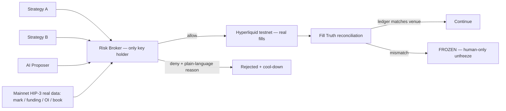

# VetoOS

**The AI-era risk-control OS for Hyperliquid HIP-3.**
*Don't trust the agent. Verify the fill. Enforce the rules. Outlast FOMO.*

VetoOS is an open-source risk broker that sits between your strategies/AI and
**real HIP-3 markets**. Models propose; rules dispose. Every order must pass a
deterministic rule engine, and every fill is reconciled against the venue's
own account state. If the books don't match reality, the broker freezes —
no exceptions, no appeals from the model.

Built for the [Colosseum Crypto World's Fair](https://colosseum.com/worldsfair) · Hyperliquid track.

## What it is / what it isn't

| Is | Isn't |
|----|-------|
| The single signing exit between strategy/AI and Hyperliquid | Another "AI calls the trades" bot |
| Deterministic rules + a fill-truth layer | An LLM giving a risk score |
| Cypherpunk: rules > models, auditable, open source by default | A closed "trust us" black box |

## How it works



1. **Propose** — strategies/AI emit a standard Intent IR; they hold no keys and
   cannot reach the exchange. Intents carrying policy-override fields are
   refused on sight.
2. **Check** — leverage, daily loss, book capacity, order frequency, same-side
   add (FOMO) limits, post-deny cool-down. Denials come with plain-language,
   bilingual reasons.
3. **Reconcile** — fills are compared against the venue's real positions
   (0.5% or 1 lot tolerance). Mismatch ⇒ global freeze until a human resets.

## Real HIP-3, not a mock

- Vetoes are computed from **live mainnet HIP-3 data**: `perpDexs` →
  `metaAndAssetCtxs { dex }` → `l2Book` (real mark, funding, OI, depth).
- Fills are placed on **testnet** with the HIP-3 asset-id rule
  `100000 + perp_dex_index * 10000 + index_in_meta` (e.g. `xyz:XYZ100` → `110000`).
- Startup **fails closed** if real market context can't be pulled.
- We guard existing HIP-3 markets; we do not stake/deploy a new dex this round.

## Quickstart

```bash
pnpm install
pnpm test            # 65 unit tests: rule engine, intent guard, reconciliation
pnpm preflight       # checks policy, keys, real mainnet + testnet paths
pnpm demo --auto     # the four-act demo (needs testnet keys — docs/TESTNET_SETUP.md)
```

### The four acts (PRD M1–M5)

| Act | Story | Proves |
|-----|-------|--------|
| 1 | strategy-a's legal intent → allow → **real testnet fill** → books match | M1, M4 |
| 2 | strategy-b's oversized intent → **denied on real mainnet HIP-3 data**; instant retry hits cool-down; AI tries to smuggle `max_leverage: 999` → refused | M2 |
| 3 | ai-proposer keeps adding same-side → **FOMO guard fires** | M3 |
| 4 | local ledger is tampered → **reconciliation freezes the broker**; only a human can unfreeze | M5 |

Record with `pnpm demo --step N`. Unwind afterwards with
`pnpm broker close --confirm I_AM_HUMAN`.

## Repo layout

```
packages/
  intent/      Intent IR schema + policy-override refusal
  risk/        deterministic rule engine (pure functions, LLM-free)
  adapter-hl/  Hyperliquid adapter: mainnet reads, testnet writes, HIP-3 asset ids
  truth/       fill-vs-position reconciliation + ledger
  audit/       JSONL audit trail with policy content hash
apps/
  demo-cli/    the Risk Broker process + four-act demo + preflight
configs/
  policy.demo.json   the rulebook (hashed into every audit record)
docs/
  PRD.md · ARCHITECTURE.md · TESTNET_SETUP.md · SUBMISSION.md
```

## Security model

- Keys exist **only** in the Risk Broker process (`.env`, gitignored).
- Fail closed everywhere: missing market data ⇒ deny; reconcile mismatch ⇒ freeze.
- Unfreeze is a human-only action (`--confirm I_AM_HUMAN`); there is no API a
  model can call to release the brake.
- The LLM can write intents and rationales. It can **never** vote on allow/deny.

## License

MIT — see [LICENSE](LICENSE).

---

## 中文速览

VetoOS 是跑在真实 HIP-3 市场之上的开源风控 OS：AI/策略只负责提案，唯一能下单的出口是写死的 Risk
Broker；用真实盘口与仓位做否决与对账，挡住失控与 FOMO。演示共四幕：合法单放行并真实成交、超仓单被主网
真实数据否决、连续同向加仓触发 FOMO 刹车、账本篡改被对账层冻结。快速开始：`pnpm install && pnpm test
&& pnpm preflight`，配置见 [测试网手册](docs/TESTNET_SETUP.md)。
