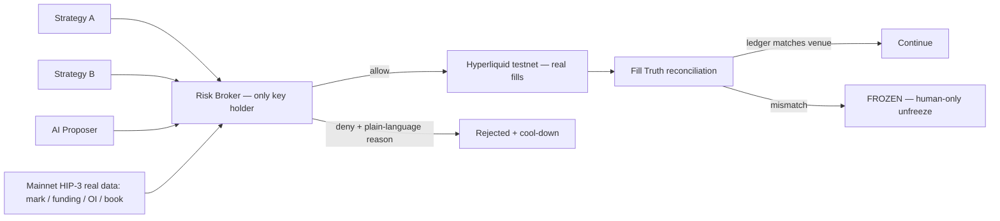

# VetoOS

[](https://github.com/rectinajh/vetoos/actions/workflows/ci.yml)
[](LICENSE)


**The AI-era risk-control OS for Hyperliquid HIP-3.**
*Don't trust the agent. Verify the fill. Enforce the rules. Outlast FOMO.*

VetoOS is an open-source risk broker that sits between your strategies/AI and
**real HIP-3 markets**. Models propose; rules dispose. Every order must pass a
deterministic rule engine, and every fill is reconciled against the venue's
own account state. If the books don't match reality, the broker freezes —
no exceptions, no appeals from the model.

Built for the [Colosseum Crypto World's Fair](https://colosseum.com/worldsfair) · Hyperliquid track.
**Proof of what actually ran:** [docs/EVIDENCE.md](docs/EVIDENCE.md) (mainnet reads, testnet fills with
oids/tx hashes, a real HIP-3 builder-dex fill, the concurrency proof).

## What it is / what it isn't

| Is | Isn't |
|----|-------|
| The single signing exit between strategy/AI and Hyperliquid | Another "AI calls the trades" bot |
| Deterministic rules + a fill-truth layer | An LLM giving a risk score |
| Cypherpunk: rules > models, auditable, open source by default | A closed "trust us" black box |

## How it works



1. **Propose** — strategies/AI emit a standard Intent IR; they hold no keys and
   cannot reach the exchange. Intents carrying policy-override fields are
   refused on sight.
2. **Check** — eleven ordered rules (freeze, market data, oracle distance,
   allow-list, notional, leverage, daily loss, cool-down, same-side adds/FOMO,
   rate limit, book depth, margin), each leaving a `pass | fail | skip` trace
   step. Denials come with plain-language, bilingual reasons.
   A **verified position-reducing order is exempt** from the rules whose only
   job is to bound what you can *open* (notional, leverage, same-side adds,
   margin) — a capped exit turns a bad position into a trapped one. The
   exemption keys off the position, not the claim: a `reduce_only` order that
   would actually open or add exposure keeps the full check
   (`reduce_only_effective` in the receipt says which one it was).
3. **Reconcile** — fills are compared against the venue's real positions
   (0.5% or 1 lot tolerance) per order *and* every 60 s for the whole session.
   Mismatch ⇒ global freeze until a human resets.

## Real HIP-3, not a mock

- Vetoes are computed from **live mainnet HIP-3 data**: `perpDexs` →
  `metaAndAssetCtxs { dex }` → `l2Book` (real mark, funding, OI, depth).
- Fills are placed on **testnet** with the HIP-3 asset-id rule
  `100000 + perp_dex_index * 10000 + index_in_meta` — `xyz:XYZ100` is asset
  `110000` on mainnet and `750000` on testnet (dex index 65). Builder dexes have
  their own clearinghouse; the broker reads `clearinghouseState { dex }` accordingly.
- Startup **fails closed** if real market context can't be pulled.
- We guard existing HIP-3 markets; we do not stake/deploy a new dex this round.

## Verifiable, not just auditable

A log you own proves nothing: the same process that writes it can rewrite it.
VetoOS separates **four properties, each with its own mechanism** — and each one
can fail on its own, which is why `pnpm verify` reports them separately.

| Property | Question it answers | Mechanism |
|---|---|---|
| Integrity | was a record changed? | hash chain: `seq` + `prev_hash` + `hash`, with `hash_alg` versioning so old logs still verify |
| Authenticity | did we really emit it? | ed25519 **receipt key**, domain-separated: `sha256/v2` canonical JSON |
| Reproducibility | was it decided by the rules in force? | the full `DecisionInput` is archived by content address; anyone re-runs `evaluateIntent` and must get the same `verdictHash`, rule-by-rule trace included |
| Non-retroactivity | can history be rewritten wholesale? | Merkle root of the receipt chain anchored on HyperEVM, `seq` monotonic |

### What makes a verdict checkable

`evaluateIntent(intent, policy, ctx)` is pure, but `ctx` carries three things that
are not derivable from the intent — `history`, `now`, `frozen`. Hashing the intent
alone would make "replay" a fiction, so the whole input is archived:

```
DecisionInput = { intent, policy, policyBytesHash, market, account,
                  history, frozen, now, engineVersion, rulesetHash }
inputsHash  = hashOf(DecisionInput)                // also the archive filename
verdictHash = hashOf({ decision, code, trace })    // what a replay must reproduce
```

- **The rules are content-addressed too.** `rulesetHash` covers `engine.ts` +
  `policy.ts`; `pnpm test` fails if a rule changed without re-stamping it. Without
  that, "the rules changed" and "the record was tampered with" look identical.
- **Canonical JSON, not `JSON.stringify`.** Key order used to leak into the digest
  (`{market,size,verdict}` and `{verdict,size,market}` hashed differently). Money and
  prices go into hashes as decimal strings, never floats.
- **The state is a projection of the log.** `history` and `frozen` are rebuilt from
  the receipts by `projectHistory` / `projectFrozen`, and a test asserts the
  projection equals the broker's live state event-for-event. There is no second
  source of truth to drift.

### AI has a seat, not a vote

| The model may | The model may never |
|---|---|
| propose an intent | sign, or reach the exchange |
| explain a rejection in plain language | take part in allow/deny |
| suggest a parameter change | alter the running policy |

Advice is **committed before the verdict and revealed after** (`/v1/ai/commit` →
`/v1/ai/reveal`): `AI_COMMIT` locks in `hashOf({nonce, advice})`, the verdict binds
that digest, and only then is the advice published. Good calls cannot be back-dated
and bad ones cannot be quietly dropped. A structural check refuses any AI-sourced
field anywhere in the control path of a `DecisionInput`, so prompt-injected text in
an intent can never become a control input.

### Three keys, three powers

| Key | Curve | Can | Cannot |
|---|---|---|---|
| `HL_PRIVATE_KEY` (agent wallet) | secp256k1 | trade | withdraw |
| operator account (your wallet) | secp256k1 (EIP-191) | unfreeze, change rules | live on the server |
| `VETOOS_RECEIPT_KEY` | ed25519 | attest receipts | trade, unfreeze |

"Only a human can release the brake" is therefore a property of the keys, not a
promise in a README: `pnpm preflight` and `brokerd` both **refuse to start** if the
hot trading key is the operator account (that would let the process mint its own
unfreeze authorisation). An unfreeze authorisation must also name the exact frozen
state — `frozenAtSeq` + chain head + one-time nonce + expiry — so a signature for
yesterday's freeze cannot open today's. Every unfreeze is recorded with the
signature that released it.

### Anchoring (selective disclosure)

`pnpm anchor` writes a Merkle root over the receipt chain; the root goes on-chain
via `contracts/VetoAnchor.sol` (HyperEVM, chain 998/999, `seq` strictly increasing
so a rollback is detectable). Anchoring 32 bytes is enough because a single receipt
can later be proven against that root with an inclusion proof — an auditor can
confirm receipt 42 without seeing any other position.

### What this does NOT prove (stated on purpose)

- Not that the **rules are wise** — only that they were followed, and that changes left a signed trail.
- Not that the **venue told the truth** — if the market snapshot is real, the verdict is real; the oracle trust boundary stays where it is.
- Not **zero-knowledge**: replay needs the inputs, so full archives are not private (`--redact` trades replayability for privacy).
- Not **immune to a fully compromised host whose anchors are not yet published** — the verifier reports the unanchored tail instead of hiding it.

Design detail: [docs/VERIFIABLE_RISK_ENGINE.md](docs/VERIFIABLE_RISK_ENGINE.md) · architecture: [docs/ARCHITECTURE.md](docs/ARCHITECTURE.md) §13.
## Quickstart

### Zero-key path (judges: start here)

```bash
pnpm install
pnpm test                 # 182 tests: rules, receipts, tamper matrix, conformance vectors
pnpm demo:offline         # the four acts on a canned, clearly-labelled fixture venue
pnpm demo:record          # same, with the cool-down WINDOW compressed for screen recording
pnpm verify               # recompute every verdict from its archived input
pnpm brokerd:offline      # the console on the fixture venue → http://127.0.0.1:4399/
```

### Recording a demo

```bash
pnpm demo:record                          # four acts, fixture venue, cool-down compressed
pnpm verify --receipts logs/recording     # a directory works: "today's audit file in there"
pnpm prove  --receipts logs/recording     # four dishonest copies, four catches
```

The shipped rulebook waits 30 s after a denial so the next act shows the right guard;
across three acts that is ~90 s of a 3-minute video spent watching a clock. `--fast`
compresses the cool-down **window** — the rule is untouched (an instant retry is still
refused and still lands in the receipt chain), the profile is written next to the
receipts, and its hash goes into every one, so the run stays auditable.
### Point it at any account (still no keys)

```bash
pnpm shadow 0xf5d81a135f756ca16544e53c20fc20643ec3ad53
pnpm shadow <address> --json --out report.json
```

Reads only public data — that address's own fills, funding and ledger movements — and replays
them through **the same deterministic engine the broker uses**, one fill at a time, with the
account state reconstructed as it was at that moment. No key, no custody, no signup.

```
YOUR TRADING PROFILE
  2000 fills over 36 minutes · 24 markets · 51% position-reducing
  order rate p50 58.0/min, p95 182.0/min · order size median $254, p95 $18,850
  where this rulebook and your style disagree:
    - order rate: your p95 is 182 orders/min, this rulebook allows 10

RESULT
  2000 orders replayed · 1992 would have been refused (99.6%)
  attributed PnL of refused orders: -$33  (the gate would have kept this much)
```

A report separates three categories instead of blurring them: rules evaluated **exactly**
(notional, same-side adds, cool-down, rate, daily realized loss, position size), rules
**reconstructed approximately** (equity, walked back through realized PnL, fees, funding and
ledger movements, so leverage and margin are labelled approximate), and rules **not evaluated
at all** (book depth — Hyperliquid publishes no historical order books, so that guard is
neutralised and named in every report rather than guessed).
### Verify a run (no keys, no trust)

```bash
pnpm verify                                  # L0 parse · L1 chain · L2 signatures · L2 replay · L3 anchor
pnpm verify --json                           # machine-readable report
pnpm verify --prove 42                       # Merkle inclusion proof for receipt 42
pnpm prove                                   # attack suite: four ways to lie, four catches
```

Real output from four-act offline runs (with a receipt key and an anchor journal configured):

```
OK   L0 parse        21 receipts, 0 unknown hash_alg
OK   L1 chain        21 receipts linked
OK   L2 signatures   9 signatures checked
OK   L2 replay       8/8 verdicts recomputed
OK   L3 anchor       21 receipts anchored (latest anchor seq 21), unanchored tail 0
head 21 10456e407bd77be8…  unanchored tail 0
RESULT: VERIFIED
```

`pnpm prove` does that for you, on the receipts a real run just produced — it makes
four dishonest copies and checks that each one is caught *and named*:

```
[baseline] untouched receipts                   VERIFIED  21 receipts · 21 linked · 8/8 verdicts recomputed
[attack 1] flip a DENY verdict to ALLOW         CAUGHT    seq 7: hash mismatch (line edited)
[attack 2] delete a receipt in the middle       CAUGHT    seq 7: seq 8 ≠ 7
[attack 3] swap the archived input behind a receipt  CAUGHT  seq 3: inputsHash mismatch (receipt 74b96310…, archive 77826c2e…)
[attack 4] anchor a root that does not match    CAUGHT    anchor seq 21: local Merkle root 847302c5… ≠ anchored 0000000… (history rewritten)

4/4 attacks caught.
```

Or do it by hand — edit one receipt, delete one, or swap one archived input:

```
FAIL L1 chain        broken at seq 7: hash mismatch (line edited)
FAIL L2 replay       seq 17: inputsHash mismatch (receipt 4603672faa1f…, archive 4d22c979ae9e…)
RESULT: FAILED
```

Offline mode uses a fixture adapter (`@vetoos/adapter-hl/fixture`) with a
drifting mark and a 10-level book; every simulated fill is tagged
`fixture: true` and the console shows an **OFFLINE** label. State lives in a
temp dir, so each run starts clean.

### Real-venue path

```bash
pnpm broker init --template conservative   # pick a policy template (degen | fund also available)
pnpm preflight                             # checks policy, keys, real mainnet + testnet paths
pnpm brokerd                               # the broker as a service → http://127.0.0.1:4399/
```

Needs an HL testnet agent wallet — see [docs/TESTNET_SETUP.md](docs/TESTNET_SETUP.md).
The console is an interactive stage for the core flow: scenario buttons fire
**real** intents, the gate animates the engine's per-rule trace, tampering
triggers the full-screen freeze takeover, and only the human button releases it.

### Propose a trade from your strategy (5 lines)

```ts
import { createClient, makeIntent } from "@vetoos/client";
const vetoos = createClient("http://127.0.0.1:4399");
const res = await vetoos.submitIntent(makeIntent({
  source: "my-strategy", market: "BTC", side: "buy", size: "0.0005", order_type: "market",
}));
console.log(res.decision?.code); // ALLOW, or a bilingual deny reason
```

Python works too — see [examples/proposer.py](examples/proposer.py). The API is
documented at `/openapi.json`; submissions are **idempotent** by `intent.id`
(concurrent duplicates share one in-flight result — one venue order, ever).

### AI proposer

```bash
pnpm proposer "buy 0.0005 BTC, momentum"   # LLM → Intent IR → broker (OPENAI_* env optional)
pnpm proposer --demo                       # incl. the smuggled-override refusal
```

### The four-act proof (PRD M1–M5)

| Act | Story | Proves |
|-----|-------|--------|
| 1 | strategy-a's legal intent → allow → **real testnet fill** → books match | M1, M4 |
| 2 | strategy-b's oversized intent → **denied on real mainnet HIP-3 data**; instant retry hits cool-down; AI tries to smuggle `max_leverage: 999` → refused | M2 |
| 3 | ai-proposer keeps adding same-side → **FOMO guard fires** | M3 |
| 4 | local ledger is tampered → **reconciliation freezes the broker**; only a human can unfreeze | M5 |

Record with `pnpm demo --step N`; reset between takes with `pnpm demo:reset`.
Unwind positions with `pnpm broker close --confirm I_AM_HUMAN`. While `brokerd`
is running, the CLI routes `status / submit / unfreeze / close` through it, and
`demo` / `demo:reset` refuse to run (single writer).

## Repo layout

```
packages/
  intent/      Intent IR schema + policy-override refusal
  risk/        deterministic rule engine (pure functions, LLM-free, per-rule trace),
               verdict.ts (DecisionInput + hashes), ruleset.ts (content-addressed rules),
               vectors/decisions.json (golden conformance vectors)
  adapter-hl/  Hyperliquid adapter: mainnet reads, testnet writes, HIP-3 asset ids,
               cloid idempotency, venue-sourced daily PnL; ./fixture = offline venue,
               ./public-reads = keyless user-parameterised reads for shadow mode
  replay/      shadow replay: real fills -> reconstructed account state -> the same
               engine, with exact/approximate/not-evaluated kept apart
  truth/       fill-vs-position reconciliation + ledger
  audit/       Veto Receipts: canonical.ts (the only hashing entry point),
               merkle.ts, receiptkey.ts (ed25519), project.ts (state = projection of the log)
  client/      typed client for the brokerd API
apps/
  brokerd/     the Risk Broker as a service: app.ts (routes, caches, auth, reconcile loop),
               server.ts (entry, single-writer lock), dashboard.ts (console), openapi.ts
  proposer-ai/ LLM → Intent IR reference proposer (no keys, no vote)
  demo-cli/    RiskBroker + CLI: init wizard, preflight, four-act demo, unwind,
               verify.ts (L0-L3 verifier), attacks.ts (pnpm prove), shadow.ts
               (keyless account report), anchor.ts, vectors-gen.ts, keys.ts
  shadowd/     read-only HTTP service: paste an address, get the shadow report.
               Holds no key and cannot trade — the deployable "live product link"
contracts/
  VetoAnchor.sol   anchors a receipt Merkle root on HyperEVM (seq must advance)
configs/
  templates/   policy templates: conservative · degen · fund
  policy.demo.json   the shipped default rulebook (hashed into every audit record)
examples/      5-line strategy integrations (TS + Python)
docs/
  PRD.md · ARCHITECTURE.md · EVIDENCE.md · TESTNET_SETUP.md · SUBMISSION.md · OPTIMIZATION.md
  zh/          Chinese originals of PRD and ARCHITECTURE
```

## Security model

- Keys exist **only** in the Risk Broker process (`.env`, gitignored). The CLI,
  proposer and console never see them.
- Fail closed everywhere: missing market data ⇒ deny; reconcile mismatch ⇒
  freeze; a venue write error burns the intent id (never retried blindly).
- `reduce_only` is **verified** against the signed venue position before it
  can waive notional/leverage/same-side checks; a claim is not a waiver.
- Unfreeze is a human-only action; there is no path a model can take to release
  the brake. The console sends the local human header; the API additionally
  accepts an operator-wallet (EIP-191) signature, but only one bound to the exact
  frozen state ("frozenAtSeq + chain head + one-time nonce + expiry"), so an old
  authorisation cannot open a later freeze. The CLI requires
  `--confirm I_AM_HUMAN`.
- Three keys, three powers. The receipt key is ed25519 and can attest a decision
  and nothing else. `pnpm preflight` and `brokerd` both refuse to start when the
  hot trading key IS the operator account, because then the process could sign its
  own unfreeze.
- Single writer: `brokerd.lock` stops a second process from trading the same account.
- Exposing `brokerd` beyond localhost requires `VETOOS_PUBLIC_TOKEN`; every
  write carries `x-vetoos-token` (constant-time compare), reads optionally too.
- Every verdict is a receipt carrying `inputsHash` + `verdictHash` +
  `rulesetHash`, so a verdict can be recomputed rather than trusted. Audit log is a
  hash chain (`seq`, `prev_hash`, `hash`); `GET /v1/audit/verify`
  and the console's chain badge detect any edited or deleted record.
- The LLM can write intents and rationales (and, optionally, an advisory
  summary on the console). It can **never** vote on allow/deny. External
  agents get one tool, `submit_intent` — see [docs/AGENT_TOOLS.md](docs/AGENT_TOOLS.md).
  There is no allow tool and no unfreeze tool.
- A caller limit more than `max_oracle_deviation_bps` from the mark (default
  500) is denied before signing. `VETOOS_FREEZE_WEBHOOK` posts on freeze;
  a failed hook never releases or delays the brake.
- Live scenario buttons on the console ask for confirmation. Offline mode
  (`pnpm brokerd:offline`) does not, and labels every fill as a fixture.

## Docs

[PRD](docs/PRD.md) · [Architecture](docs/ARCHITECTURE.md) · [Evidence](docs/EVIDENCE.md) ·
[Agent tools](docs/AGENT_TOOLS.md) · [Testnet setup](docs/TESTNET_SETUP.md) ·
[Submission](docs/SUBMISSION.md) · [Contributing](CONTRIBUTING.md)

## License

MIT — see [LICENSE](LICENSE).

---

## 中文速览

VetoOS 是跑在真实 HIP-3 市场之上的开源风控 OS：AI/策略只负责提案，唯一能下单的出口是写死的 Risk
Broker；用真实盘口与仓位做否决与对账，挡住失控与 FOMO。演示共四幕：合法单放行并真实成交、超仓单被主网
真实数据否决、连续同向加仓触发 FOMO 刹车、账本篡改被对账层冻结。无钥匙快速体验：`pnpm install && pnpm
demo:offline`；真实测试网配置见 [测试网手册](docs/TESTNET_SETUP.md)；中文 PRD 与架构文档见
[docs/zh](docs/zh)。
